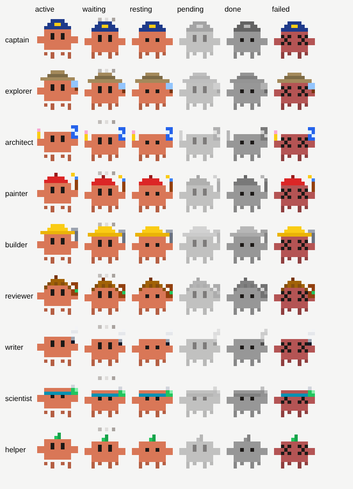

# agent-crew

A side pane for Claude Code that shows your whole crew of agents at a glance: the main agent and every subagent it starts, each drawn as a little pixel critter dressed for its role.



## What it shows

For each agent, in a tree that follows who started whom:

- **Status**: queued, working, waiting, idle, done, failed or stopped. Working critters walk and bob, waiting ones blink and think, finished ones turn grey and stay in the list until you clear them.
- **What it is doing now**: the file it reads or edits, the command it runs, the search it makes, the task it hands off.
- **Model and effort** of its latest request, how long it has been running, how many steps and tool calls it has made.
- **Tokens** (input, output and cache) and an **estimated cost** in US dollars.

The header adds up the estimate for the whole crew and, beside it, the session's own cost as `/cost` reports it.

The estimate uses Anthropic's first-party list prices per model (see `hooks/pricing.ts`). On a Pro or Max plan it is what the same tokens would cost on the API, not what you pay.

## With model-router

When the [model-router](../model-router) mod is installed too, each agent it routed gets one more line: its tier, the model it went to and why (keywords, your rule, the agent type, or Haiku's judgment), and what that saved. The header adds up the savings. Without the router the line is simply not there.

## Costumes

The main agent is always the **captain**. Every other agent gets a costume from its type and from words in its task description:

| Costume | Picked for |
| --- | --- |
| explorer | `Explore` agents; search, find, look, scout |
| architect | `Plan` agents; plan, architecture, blueprint |
| painter | design, UI, UX, CSS, style, visual, layout |
| builder | implement, build, fix, refactor, code, migrate |
| reviewer | review, audit, verify, check, test, lint |
| writer | docs, write, README, translate, summarize |
| scientist | research, analyze, data, investigate, benchmark |
| helper | anything else |

Italian words work too (cerca, disegna, verifica, scrivi, ...).

## Settings

| Setting | Default | What it does |
| --- | --- | --- |
| `language` | `en` | Labels in English (`en`) or Italian (`it`). |
| `costumes` | empty | Your own rules, checked first: comma separated `keyword=costume` pairs, e.g. `wiki=writer, thesis=scientist`. |
| `autoOpen` | `true` | Open the pane when a session starts. |

The `/crew` command opens the pane at any time.

## Surfaces

The desktop app, the web and the IDE draw the critters as animated SVG. A terminal draws them with half-block characters, the legs stepping once a second.

## Install

```
/plugin install agent-crew --marketplace Andrea-Logo/claude-mods
```

or, in the desktop app, **+** → **Plugins** → **Add marketplace** `Andrea-Logo/claude-mods` → **Add plugin**.
